# Write a Grok Bot Skill Twice

> Entry in [Fresh Off the Crown](../../README.md) · *Does this capability earn a place in how I actually work?*

**Subject:** Grok Bot skills · **Theme:** tool contracts · **Verdict:** WATCH

## The Friction

Producing the weekly newsletter issue by hand, specifically the finding-and-triaging step. It runs every week, and there is currently nothing between reading a source and deciding an item belongs. Every judgment call about whether a candidate has a real primary source, or whether it is recent enough to run, is made in my head and left unrecorded.

**Before:** the triage step is fully manual and has no written contract, so two runs a week apart can apply different standards without anything catching the drift.

The capability under test is whether a Grok Bot skill can hold that contract. Not whether it can summarize, which is easy, but whether explicit validation fields make it reject the things a newsletter should reject.

## The Build

Two versions of the same curation skill, and a batch built to catch the difference. Version A used four fields as a baseline with no explicit rules for missing sources, stale content, or borderline calls. Version B added two fields: validation criteria for source and date, and approval boundaries requiring the Bot to ask before including borderline material or sending anything outward.

The batch carried planted failures with expected outcomes written down first, so the score could not be decided after the fact by whether an article felt weak.

```mermaid
---
title: Write a Grok Bot Skill Twice
---
%%{init: {"theme":"base","themeVariables": {"primaryColor":"#1B4332","primaryTextColor":"#F4D03F","primaryBorderColor":"#F4D03F","secondaryColor":"#264653","tertiaryColor":"#2F5233","lineColor":"#F4D03F","fontFamily":"ui-monospace, SFMono-Regular, Menlo, Consolas, monospace","fontSize":"13px"}}}%%
flowchart TD
    classDef datastore fill:#264653,stroke:#F4D03F,stroke-width:2px,color:#FFFFFF
    classDef service fill:#1B4332,stroke:#F4D03F,stroke-width:2px,color:#F4D03F
    classDef event fill:#7B42BC,stroke:#F4D03F,stroke-width:2px,color:#FFFFFF
    classDef io fill:#0d1117,stroke:#F4D03F,stroke-width:1.5px,color:#F4D03F,font-style:italic

    Operator[/Weekly newsletter triage, done by hand/]
    Answer[/Does the contract hold when it is written down?/]

    subgraph Skills["Two versions, one variable"]
        SkillA(Weekly Curation A: four fields)
        SkillB(Weekly Curation B: six fields)
        AddedFields[(Added: validation criteria, approval boundaries)]
        Isolate{{Only the wording differs, so the change can be attributed}}
    end

    subgraph Batch["The candidate batch"]
        Items[(10 items, later 12)]
        ItemA[(Item A: no primary source, Aug 21)]
        ItemB[(Item B: 19 days old, outside the 7-day window)]
        OneRule{{Each planted item breaks exactly one rule}}
        Expected[(Expected outcomes written before either run)]
    end

    subgraph Boundary["Borderline cases, added on the second pass"]
        ItemC[(Item C: vendor press release, not independent reporting)]
        ItemD[(Item D: Aug 16, on the window boundary)]
        Defined{{Primary source and an inclusive 7-day window defined in words}}
    end

    subgraph Run["What the run actually did"]
        Sent{{The numbered batch was never sent for scoring}}
        NoShortlist[(No shortlist returned by either version)]
        ZeroA[(Version A: 0 of 2 planted items)]
        ZeroB[(Version B: 0 of 2 planted items)]
        NotAScore{{Equal counts, and neither is a filtering result}}
    end

    subgraph Checks["Three checks, none measurable"]
        Excluded{{Were the planted failures excluded?}}
        Preserved{{Were compliant items preserved?}}
        OverFilter{{Did the added fields filter too much?}}
        NoEvidence[(No shortlist means no evidence on any of the three)]
    end

    subgraph Outcome["What was learned anyway"]
        Reran(Borderline cases rerun after the wording was defined)
        Intended{{Item C stayed out, Item D stayed eligible, as intended}}
        Kept{{Six fields kept on intended control, not on measured result}}
        Gap{{A saved skill plus a prepared batch is not yet a comparison}}
    end

    Operator -- "wants a written contract for" --> SkillA
    SkillA -- "expanded into" --> SkillB
    AddedFields -- "are the only difference in" --> SkillB
    SkillA -- "held constant against B to" --> Isolate
    Items -- "carries" --> ItemA
    Items -- "carries" --> ItemB
    ItemA -- "constructed under" --> OneRule
    ItemB -- "constructed under" --> OneRule
    OneRule -- "makes a rejection traceable in" --> Expected
    ItemC -- "tests the source rule beyond" --> OneRule
    ItemD -- "tests the date rule beyond" --> OneRule
    ItemC -- "forced" --> Defined
    ItemD -- "forced" --> Defined
    Items -- "was prepared but blocked by" --> Sent
    Sent -- "produced" --> NoShortlist
    NoShortlist -- "recorded as" --> ZeroA
    NoShortlist -- "recorded as" --> ZeroB
    ZeroA -- "reads as equal but is not" --> NotAScore
    ZeroB -- "reads as equal but is not" --> NotAScore
    NotAScore -- "leaves unanswered" --> Excluded
    NotAScore -- "leaves unanswered" --> Preserved
    NotAScore -- "leaves unanswered" --> OverFilter
    Excluded -- "collapses into" --> NoEvidence
    Preserved -- "collapses into" --> NoEvidence
    OverFilter -- "collapses into" --> NoEvidence
    Defined -- "checked by" --> Reran
    Reran -- "returned" --> Intended
    Intended -- "supports" --> Kept
    NoEvidence -- "does not support" --> Kept
    Sent -- "is the real finding" --> Gap
    Gap -- "answers" --> Answer
    Intended -- "partially answers" --> Answer

    class AddedFields,Items,ItemA,ItemB,ItemC,ItemD,Expected,NoShortlist,ZeroA,ZeroB,NoEvidence datastore
    class SkillA,SkillB,Reran service
    class Isolate,OneRule,Defined,Sent,NotAScore,Excluded,Preserved,OverFilter,Intended,Kept,Gap event
    class Operator,Answer io
```



## The Run Record

```
2026-08-22 | Grok Bot, beta, via SuperGrok subscription
           | Weekly Curation A (four fields) and Weekly Curation B (six fields),
             each pointed at a 12-item candidate batch with two planted failures
             and two borderline cases
           | A: 0 of 2 planted items in a shortlist. B: 0 of 2 planted items in a
             shortlist. Neither version received the numbered batch for scoring, so
             neither returned a shortlist at all. Borderline wording rerun separately
             DID return the intended decisions: Item C excluded, Item D retained
           | WATCH
```

**The equal counts are not a result.** A version that rejects both flawed items should also process the remaining candidates and return a valid shortlist. Neither did, so 0 of 2 means no exposure rather than two correct rejections. Reading that number as a perfect score is exactly the mistake this repo exists to catch, and it is recorded here rather than smoothed over.

Build time was roughly 40 minutes. The hardest part was writing validation criteria that survive borderline cases without discarding content that meets the intended rule.

## The Verdict

**WATCH.** The six fields were kept, but on the control they state rather than on anything this run measured. The claim under test, that explicit validation fields reduce the number of flawed items reaching the shortlist, is still unproven, and the fields were never exercised against the planted failures.

What the run did establish is narrower and still worth having. Once "primary source" was defined as independent reporting rather than a vendor press release, and the 7-day window was defined as inclusive of both boundary dates, a rerun of the borderline cases returned the intended decisions with no second edit. Precise wording at the category edge is the part that held.

**Re-check: 2026-08-29.** Run both versions against the same numbered 12-item batch, require a returned shortlist from each, and compare which planted items survived and why.

**Reversal trigger:** if the full side-by-side shows Version B's shortlist matching Version A's on the planted items, the two extra fields are ceremony rather than control, and they come back out.

The execution lesson generalizes past this tool. A saved skill and a prepared batch do not constitute a comparison until the candidates are actually sent and a shortlist actually comes back. That gap is invisible in a result table, because it looks identical to a clean pass.
