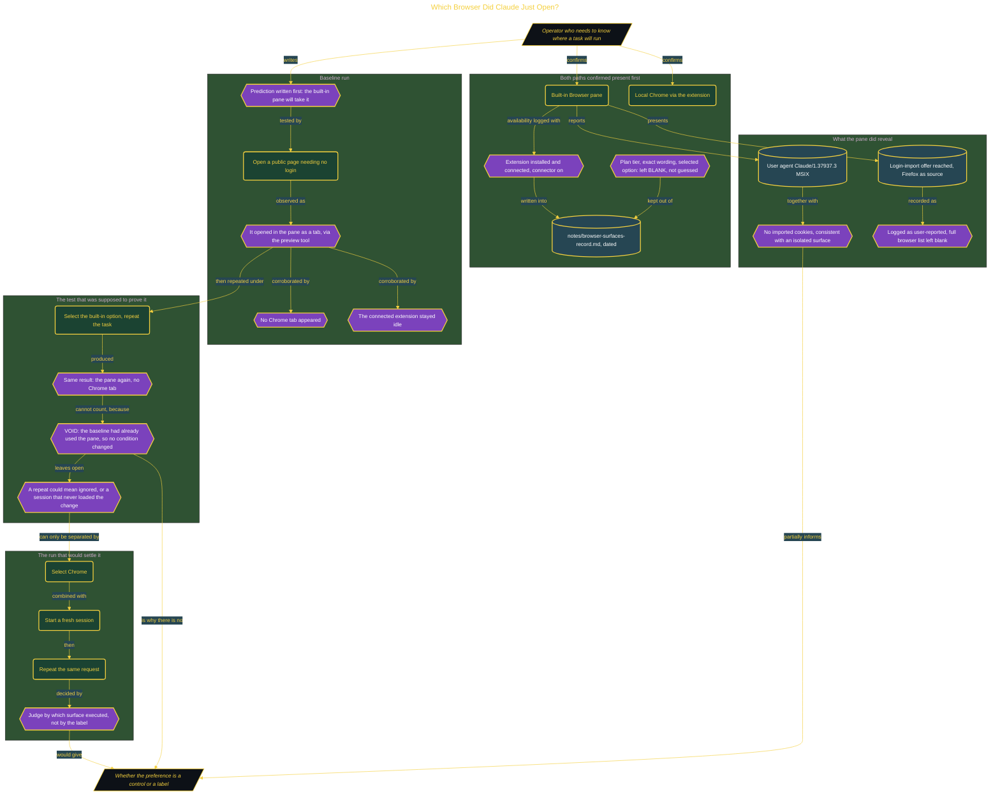

# Which Browser Did Claude Just Open?

> Part of [Fresh Off the Crown](../../README.md) · *A daily practice deciding what earns a place in the work.*

## Overview

A setting that names two options is not proof that either one is wired to anything. When a web task can land either in the built-in Browser pane or in local Chrome through the extension, and a preference exists that claims to choose, the honest question is whether the label controls the routing or merely describes an intention. Guessing wrong means a task that needs a signed-in profile silently runs somewhere that has no cookies.

The method makes the artifact decide, never the assistant's account of itself. The surfaces were recorded first: the extension installed and connected, the connector on, and the built-in pane available, so both paths demonstrably existed before the test. Three fields the record could not verify, the plan tier, the exact wording of the preference, and which option was selected, were left blank rather than filled from memory. A prediction was written, then a public page was opened and judged by where it appeared: the built-in pane took it as a tab through the preview tool, no Chrome tab appeared, and the connected extension stayed idle throughout.

Then the reversal failed to be a reversal, and that is the finding. Switching to the built-in option and repeating the task produced the same result, but the comparison is void because the baseline had already used that surface, so no condition changed between runs. Two matching observations look like confirmation and carry no information about the setting at all. A repeated result could equally mean the preference is ignored, or that the running session never loaded the change. The user agent and absence of imported cookies do confirm the pane is a genuinely isolated surface, and the login-import offer was reached with Firefox as the source and logged as user-reported rather than independently verified, with the full browser list left blank. Verdict **WATCH**. The Chrome leg is the only run that can expose an ignored or session-scoped preference: select Chrome, start a fresh session, repeat the request, inspect both surfaces. Re-check 2026-09-03.

## Architecture

The diagram shows the topology and data flow of the system as built. The captured evidence for this run, including screenshots of what the tools actually returned, lives in [`documents/browser-surface-routing.md`](./documents/browser-surface-routing.md).

## Implementation

This system is built across **6 phases**:

1. Project Overview
2. Recording the Rollout: Did the Built-In Browser Arrive?
3. Watching Which Browser Actually Opens
4. Testing the Preferred Browser Setting in Both Directions
5. Reading the Login-Import Offer Without Accepting It
6. Applying the Method to Another Tool

For the run as it happened, with the screenshots taken at each step, see [`documents/browser-surface-routing.md`](./documents/browser-surface-routing.md).

## Validation

Each phase below has its evidence in [`documents/browser-surface-routing.md`](./documents/browser-surface-routing.md), with the screenshots, configuration, and observed results recorded as the run happened:

- ✅ Project Overview
- ✅ Recording the Rollout: Did the Built-In Browser Arrive?
- ✅ Watching Which Browser Actually Opens
- ✅ Testing the Preferred Browser Setting in Both Directions
- ✅ Reading the Login-Import Offer Without Accepting It
- ✅ Applying the Method to Another Tool
