# Test Claude Code Budget Controls

> Part of [Fresh Off the Crown](../../README.md) · *A daily practice deciding what earns a place in the work.*

## Overview

A cost flag is only worth setting if you know what it does when it fires. Claude Code takes a budget limit on the command line, and the question is narrow: can it be relied on as a local cost control in a Windows print-mode workflow, and what exactly does it stop. The run plan, the evidence fields, the arithmetic, and the verdict rules were written before execution, on version 2.1.252, under subscription authentication with the API-key environment variable confirmed absent so the run could not route to pay-as-you-go billing.

The measurement carries the finding. Against a cap of 0.0001 the client reported a total of 0.000973 and stopped, a difference of 0.000873 held in decimal and rounded only for display. That is roughly **9.7 times the cap**, so the control is a post-hoc trip wire and not a gate: it completed and priced one full turn, then compared and halted, so overshoot scales with that first turn rather than with the cap. Print mode returned a machine-readable budget-exceeded subtype. The same flag without print mode also stopped before any model answer, but through plain text on standard error, contradicting help text describing the flag as print-only. A field the plan expected did not exist in this version, and that gap was appended as a divergence rather than written out of the criteria.

Verdict **WATCH**, re-check 2026-12-02 or the next minor release. The control works, but scope disagrees with behavior, the expected field is missing, and no terminal was attached, so this proves non-print enforcement and says nothing about the full interactive interface. Both reversals were declared in advance: REJECT if a repeatable run shows the cap failing to stop at all, ADOPT if a later build matches its documented scope in a real terminal and restores the field. The contrary test is specified at three attempts under an attached terminal, where three normal answers would prove the flag inactive there. Every number here is a local estimate, not an invoice.

## Architecture

```mermaid
---
title: Test Claude Code Budget Controls
---
%%{init: {"theme":"base","themeVariables": {"primaryColor":"#1B4332","primaryTextColor":"#F4D03F","primaryBorderColor":"#F4D03F","secondaryColor":"#264653","tertiaryColor":"#2F5233","lineColor":"#F4D03F","fontFamily":"ui-monospace, SFMono-Regular, Menlo, Consolas, monospace","fontSize":"13px"}}}%%
flowchart TD
    classDef datastore fill:#264653,stroke:#F4D03F,stroke-width:2px,color:#FFFFFF
    classDef service fill:#1B4332,stroke:#F4D03F,stroke-width:2px,color:#F4D03F
    classDef event fill:#7B42BC,stroke:#F4D03F,stroke-width:2px,color:#FFFFFF
    classDef io fill:#0d1117,stroke:#F4D03F,stroke-width:1.5px,color:#F4D03F,font-style:italic

    Operator[/Operator wanting a dependable local cost ceiling/]
    Decision[/Whether the flag can be relied on/]

    subgraph Plan["Pre-registered before execution"]
        Criteria[("Cap, mode, auth, output format, required fields, arithmetic")]
        Verdicts{{"Adopt, watch and reject rules written before any run"}}
        Appended{{"Divergences appended later, never edited into the original plan"}}
    end

    subgraph Baseline["The credential and platform baseline"]
        Version[("Claude Code 2.1.252 on Windows")]
        NoKey{{"API-key environment variable confirmed absent"}}
        Subscription{{"So usage draws on the subscription, not a separate billing path"}}
        NotInvoice{{"Every figure is a local client estimate, never a charge record"}}
    end

    subgraph PrintRun["Print mode, cap 0.0001"]
        RawJson("Complete JSON result captured before any field was read")
        Cap[("Configured cap: 0.0001")]
        Total[("Reported total: 0.000973")]
        Diff[("Difference: 0.000873, decimal, rounded only to display")]
        Subtype[("Machine-readable budget-exceeded result subtype")]
    end

    subgraph Nature["What the stop actually is"]
        PostHoc{{"One turn completed and priced, then compared, then stopped"}}
        Ratio{{"About 9.7 times the cap"}}
        Scales{{"Overshoot tracks the size of the first turn, not the cap value"}}
        NotGate{{"A trip wire after the fact, not a gate before the spend"}}
    end

    subgraph NonPrint["Same flag, no print mode"]
        SecondRun("Second invocation, identical cap")
        Halted[("Stopped before producing any model answer")]
        Stderr[("Plain error text on standard error, no structured envelope")]
        HelpSays{{"Help text describes the flag as print-only"}}
        Contradiction{{"Documented scope disagrees with tested behavior"}}
    end

    subgraph Gaps["What stayed unproven"]
        MissingField{{"A pre-registered result field does not exist in this version"}}
        NoTty{{"No terminal attached, so the full interactive path is untested"}}
        Bounded{{"Claim held to Windows, this version, these two modes"}}
    end

    subgraph Close["Verdict and its exits"]
        Watch{{"WATCH: it works, its scope and schema do not agree"}}
        Recheck[("Re-check 2026-12-02 or the next minor release")]
        ToReject{{"REJECT if a repeatable run shows the cap failing to stop at all"}}
        ToAdopt{{"ADOPT if a later build matches documented scope in a real terminal and restores the field"}}
        ThreeRuns("Contrary test: three attempts under an attached terminal")
    end

    Operator -- "writes" --> Criteria
    Criteria -- "declares" --> Verdicts
    Criteria -- "amended only by" --> Appended
    Operator -- "establishes" --> Version
    Version -- "checked for" --> NoKey
    NoKey -- "fixes precedence, giving" --> Subscription
    Subscription -- "bounded by" --> NotInvoice
    Version -- "runs print mode, producing" --> RawJson
    Criteria -- "supplies" --> Cap
    RawJson -- "yields" --> Total
    Cap -- "subtracted from Total gives" --> Diff
    Total -- "subtracted against the cap gives" --> Diff
    RawJson -- "yields" --> Subtype
    Diff -- "being positive shows" --> PostHoc
    Diff -- "expressed as" --> Ratio
    Ratio -- "implies" --> Scales
    PostHoc -- "means the control is" --> NotGate
    NotInvoice -- "limits what NotGate can claim" --> NotGate
    Version -- "then runs" --> SecondRun
    SecondRun -- "produced" --> Halted
    Halted -- "surfaced as" --> Stderr
    Stderr -- "differs in shape from" --> Subtype
    Halted -- "measured against" --> HelpSays
    HelpSays -- "produces" --> Contradiction
    Criteria -- "expected a field that turned out missing" --> MissingField
    MissingField -- "recorded through" --> Appended
    SecondRun -- "ran without a terminal, leaving" --> NoTty
    NoTty -- "with the platform fix gives" --> Bounded
    NotGate -- "supports" --> Watch
    Contradiction -- "supports" --> Watch
    MissingField -- "supports" --> Watch
    Verdicts -- "sets the exits for" --> Watch
    Watch -- "carries" --> Recheck
    Watch -- "reverses to" --> ToReject
    Watch -- "reverses to" --> ToAdopt
    NoTty -- "is what" --> ThreeRuns
    ThreeRuns -- "would settle" --> ToAdopt
    Bounded -- "keeps the scope honest for" --> Decision
    Watch -- "is" --> Decision

    class Criteria,Version,Cap,Total,Diff,Subtype,Halted,Stderr,Recheck datastore
    class RawJson,SecondRun,ThreeRuns service
    class Verdicts,Appended,NoKey,Subscription,NotInvoice,PostHoc,Ratio,Scales,NotGate,HelpSays,Contradiction,MissingField,NoTty,Bounded,Watch,ToReject,ToAdopt event
    class Operator,Decision io
```

The diagram shows the topology and data flow of the system as built. The captured evidence for this run, including screenshots of what the tools actually returned, lives in [`documents/budget-cap-trip-wire.md`](./documents/budget-cap-trip-wire.md).

## Implementation

This system is built across **7 phases**:

1. Measuring the Local Budget Stop
2. Testing the Interactive Mode Boundary
3. Reaching an Evidence-Backed Control Verdict
4. Challenging the Verdict With Contrary Evidence
5. Establishing a Subscription-Only Windows Baseline
6. Pre-Registering the Test and Its Boundaries
7. Defining the Operational Decision

For the run as it happened, with the screenshots taken at each step, see [`documents/budget-cap-trip-wire.md`](./documents/budget-cap-trip-wire.md).

## Validation

Each phase below has its evidence in [`documents/budget-cap-trip-wire.md`](./documents/budget-cap-trip-wire.md), with the screenshots, configuration, and observed results recorded as the run happened:

- ✅ Measuring the Local Budget Stop
- ✅ Testing the Interactive Mode Boundary
- ✅ Reaching an Evidence-Backed Control Verdict
- ✅ Challenging the Verdict With Contrary Evidence
- ✅ Establishing a Subscription-Only Windows Baseline
- ✅ Pre-Registering the Test and Its Boundaries
- ✅ Defining the Operational Decision
