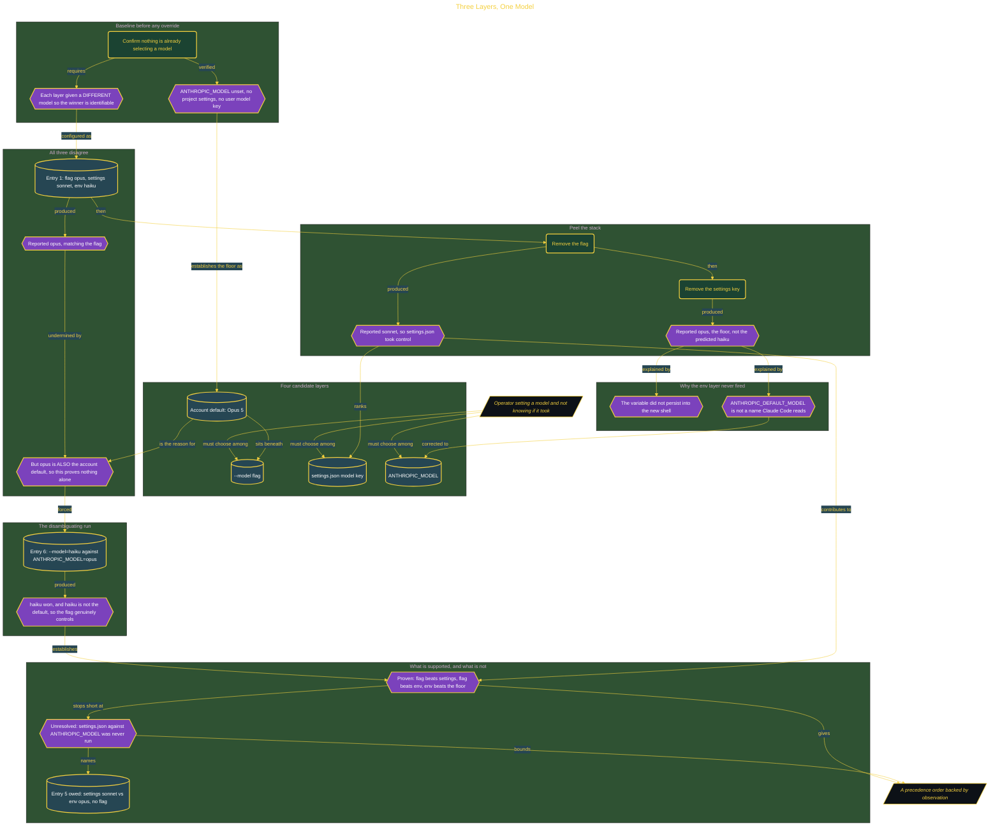

# Three Layers, One Model

> Part of [Fresh Off the Crown](../../README.md) · *A daily practice deciding what earns a place in the work.*

## Overview

Claude Code takes a model from a command-line flag, a settings file, an environment variable, and an account default. When two of them disagree, nothing tells you which one won. Set a model in the wrong place and the session quietly runs something else, and the output looks identical either way.

**Before:** model selection was set by habit with no way to confirm it took effect, so a change to one layer might do nothing and never announce it.

The experiment gives each layer a different model so the winner is identifiable, and establishes the floor first: with the variable unset, no project settings, and no user model key, the account resolves to Opus 5. That floor turns out to be the whole difficulty. The first run configured the flag to opus, settings to sonnet, and the environment to haiku, and reported opus, which looks like a clean win for the flag. It is not evidence. Opus is also the account default, so the identical output would appear if all three overrides had failed.

Peeling the stack produced the one transition the run does prove. Removing the flag reported sonnet, so the settings file takes control when the flag is gone. Removing the settings key reported opus rather than the predicted haiku, because the environment layer had never been active at all: the variable did not survive into the new shell, and `ANTHROPIC_DEFAULT_MODEL` is not a name Claude Code reads. Entries 1, 3, and 4 all displayed opus for three different reasons, which is the trap the whole design exists to expose.

A later run broke the tie by making the flag disagree with the floor. `--model=haiku` against `ANTHROPIC_MODEL=opus` returned haiku, and because haiku is not the account default, that is genuine evidence the flag controls the result rather than a fallback coincidence.

The verdict is **ADOPT** for `--model` as the control surface for per-session model choice, and for `ANTHROPIC_MODEL` as the correct variable name over the one that silently does nothing. **What is deliberately not claimed:** the order between `settings.json` and `ANTHROPIC_MODEL` is still unknown, because the run that would settle it, settings at sonnet against the environment at opus with no flag, was never executed. The supported order is partial: flag above both, environment above the floor.

**Re-check 2026-08-30:** run that missing comparison and close the middle of the order. **Reversal trigger:** any run where `--model` fails to override a set `ANTHROPIC_MODEL`, which would mean the precedence changed and every conclusion here needs re-testing.

```
Run record
2026-08-24 | Claude Code, account default Opus 5 (claude-opus-5)
           | Conflicting model values across --model, settings.json, ANTHROPIC_MODEL,
             then removing one layer at a time and recording the active model
           | flag opus / settings sonnet / env haiku returned opus (confounded by the
             floor). Flag removed returned sonnet. Settings key removed returned opus,
             not haiku, because the variable never persisted and the name was wrong.
             --model=haiku against ANTHROPIC_MODEL=opus returned haiku, which is the
             one unconfounded result
           | ADOPT
```

## Architecture



The diagram shows the topology and data flow of the system as built. The full architectural narrative, with screenshots and prose, lives in [`documents/default-model-precedence.md`](./documents/default-model-precedence.md).

## Implementation

This system is built across **5 phases**:

1. Estimating the Precedence Order
2. Setting Up the Experiment
3. Making All Three Layers Disagree
4. Peeling the Stack to Find the Fallback Order
5. Discovering the Fourth Layer

For the full walkthrough with screenshots and step-by-step content, see [`documents/default-model-precedence.md`](./documents/default-model-precedence.md).

## Validation

Each build phase below is documented in [`documents/default-model-precedence.md`](./documents/default-model-precedence.md), with screenshots, configuration, and notes as captured during the build:

- ✅ Estimating the Precedence Order
- ✅ Setting Up the Experiment
- ✅ Making All Three Layers Disagree
- ✅ Peeling the Stack to Find the Fallback Order
- ✅ Discovering the Fourth Layer
