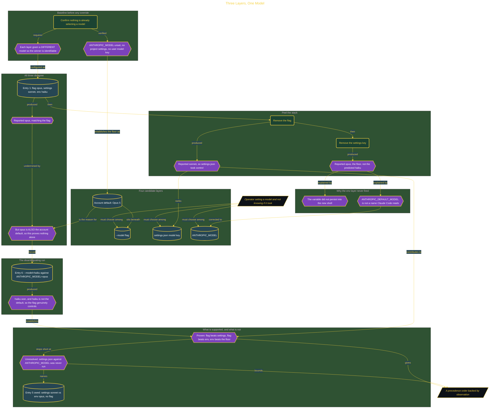

# Three Layers, One Model

> Part of [Fresh Off the Crown](../../README.md) · *A daily practice deciding what earns a place in the work.*

## Overview

Claude Code takes a model from a command-line flag, a settings file, an environment variable, and an account default. When two disagree, nothing tells you which won. Set a model in the wrong place and the session quietly runs something else, and the output looks identical either way, so model selection was set by habit with no way to confirm it took effect.

The experiment gives each layer a different model so the winner is identifiable, and establishes the floor first: with the variable unset, no project settings, and no user model key, the account resolves to Opus 5. That floor turns out to be the whole difficulty. The first run set the flag to opus, settings to sonnet, and the environment to haiku, and reported opus, which looks like a clean win for the flag and is not evidence, because the identical output would appear if all three overrides had failed.

Peeling the stack produced the one transition it proves. Removing the flag reported sonnet, so the settings file takes control when the flag is gone. Removing the settings key reported opus rather than the predicted haiku, because the environment layer was never active: the variable did not survive into the new shell, and `ANTHROPIC_DEFAULT_MODEL` is not a name Claude Code reads. A later run broke the tie by making the flag disagree with the floor, and `--model=haiku` against `ANTHROPIC_MODEL=opus` returned haiku, which is the one unconfounded result. Verdict **ADOPT** for `--model` as the control surface, with the order between `settings.json` and `ANTHROPIC_MODEL` left explicitly unresolved because that comparison was never run. Re-check 2026-08-30. Reversed if `--model` ever fails to override a set `ANTHROPIC_MODEL`.

## Architecture

The diagram shows the topology and data flow of the system as built. The captured evidence for this run, including screenshots of what the tools actually returned, lives in [`documents/default-model-precedence.md`](./documents/default-model-precedence.md).

## Implementation

This system is built across **5 phases**:

1. Estimating the Precedence Order
2. Setting Up the Experiment
3. Making All Three Layers Disagree
4. Peeling the Stack to Find the Fallback Order
5. Discovering the Fourth Layer

For the run as it happened, with the screenshots taken at each step, see [`documents/default-model-precedence.md`](./documents/default-model-precedence.md).

## Validation

Each phase below has its evidence in [`documents/default-model-precedence.md`](./documents/default-model-precedence.md), with the screenshots, configuration, and observed results recorded as the run happened:

- ✅ Estimating the Precedence Order
- ✅ Setting Up the Experiment
- ✅ Making All Three Layers Disagree
- ✅ Peeling the Stack to Find the Fallback Order
- ✅ Discovering the Fourth Layer
