# Calibrate Claude Code Effort

> Part of [Fresh Off the Crown](../../README.md) · *A daily practice deciding what earns a place in the work.*

## Overview

Leaving the effort setting on high for every task is a default nobody has priced. The honest question is not which setting wins in general but whether a lower one is sufficient for a specific job, and that needs an experiment which cannot be talked out of its result. So this build is the harness, not the opinion: a preregistered repair fixture, two isolated runs, an unchanged checker, and a decision made by code.

The controls are the work. Three mutations against an invoice calculation and the acceptance rule were timestamped, hashed, and sealed into a pre-artifacts folder before the first model call, so faults could not be reselected to flatter a result and the bar could not move afterwards. A known-good implementation in integer cents had to pass its checker first, which proves a later failure is the planted fault and not a broken assertion. Both arms started from byte-identical workspaces, each failing independently before repair, on the same pinned model, prompt, and 8-turn cap, in separate processes with distinct session IDs, leaving the effort value as the only intended difference. The checker's own hash was verified unchanged in both arms, which stops a model passing by editing its own test. The preflight gate earned its place too, halting the first attempt when its scan of 13 metered or routing variables found a base-URL override.

The keeper is the fail-closed proof. `decision_for()` evaluates one boolean chain, returning the lower setting only when every clause passes and the higher one otherwise. High finished in 7 turns, putting the ceiling at 8; tampering the medium count to 9 made that single clause false and the rule returned the safe default even though every other control passed, with no partial credit and no averaging. **ADOPT** the calibration method, not a blanket effort downgrade. The recommendation is confined to this one invoice repair and says nothing about unfamiliar repositories, multi-file changes, or architectural work. That limit is the reversal trigger: the design has to hold on a multi-file refactor before its output travels further.

## Architecture

```mermaid
---
title: Calibrate Claude Code Effort
---
%%{init: {"theme":"base","themeVariables": {"primaryColor":"#1B4332","primaryTextColor":"#F4D03F","primaryBorderColor":"#F4D03F","secondaryColor":"#264653","tertiaryColor":"#2F5233","lineColor":"#F4D03F","fontFamily":"ui-monospace, SFMono-Regular, Menlo, Consolas, monospace","fontSize":"13px"}}}%%
flowchart TD
    classDef datastore fill:#264653,stroke:#F4D03F,stroke-width:2px,color:#FFFFFF
    classDef service fill:#1B4332,stroke:#F4D03F,stroke-width:2px,color:#F4D03F
    classDef event fill:#7B42BC,stroke:#F4D03F,stroke-width:2px,color:#FFFFFF
    classDef io fill:#0d1117,stroke:#F4D03F,stroke-width:1.5px,color:#F4D03F,font-style:italic

    Operator[/Operator leaving effort on high by default/]
    Decision[/Whether a lower setting is sufficient here/]

    subgraph Preflight["The gate that runs before any model call"]
        Attestation[("Access attestation: eligible plan, included model, credits disabled, subscription login")]
        Scan("Scan of 13 metered or routing variables plus the effort variable")
        Caught[("First attempt stopped: a base-URL override was present")]
        WhyStop{{An unexpected route would have been a hidden variable across the two arms}}
        Versions[("Recorded tool state: Python 3.14.7, client 2.1.252, editor absent")]
        KeptAbsence{{The missing editor recorded as absent rather than substituted}}
    end

    subgraph Prereg["Preregistration, sealed before the first call"]
        Mutations[("Three code mutations against the invoice calculation")]
        Rule[("Acceptance rule: checker success, artifact integrity, workspace parity, turn limit")]
        Hashed("Timestamped, hashed, copied to the pre-artifacts folder")
        Unchanged[("pre_artifacts_unchanged confirmed true after the run")]
        NoReselect{{Faults cannot be reselected to favour an arm}}
        NoRebar{{The success bar cannot move once the arms have run}}
    end

    subgraph Baseline["The known-good control"]
        KnownGood("Invoice calculation in integer cents, no floating point reference")
        Checker("check_invoice.py, the executable definition of repaired")
        CleanPass[("Clean fixture passes before any mutation")]
        WhyFirst{{A clean pass proves a later failure is the planted fault, not a broken assertion}}
        NotOpinion{{Repaired means the checker returns success, never that the code looks right}}
    end

    subgraph Arms["Two arms, one intended difference"]
        Fixture[("Broken fixture, failing as designed")]
        High("High-effort run")
        Medium("Medium-effort run")
        SameHash[("Byte-identical starting workspaces")]
        BothFail[("Each copy independently fails before repair")]
        Constant{{Same pinned model, same prompt, same 8-turn cap}}
        Isolated{{Separate processes, distinct session IDs, no persistence between them}}
        OnlyEffort{{Only the effort value differs}}
        CheckerHash{{Checker hash verified unchanged in both arms}}
        NoSelfPass{{So neither model can pass by editing its own test}}
    end

    subgraph Verdict["The decision, produced by code"]
        DecisionFor("decision_for evaluates one boolean chain")
        Turns[("High finished in 7 turns, so the permitted ceiling is 8")]
        AllPass{{Lower setting returned only when every clause passes}}
        Else{{Every other outcome returns the higher setting}}
        NoPartial{{No partial credit, no averaging a failed requirement with passing controls}}
    end

    subgraph FailClosed["The tamper test"]
        Tamper("Medium turn count tampered to 9")
        OneFalse[("That single clause returns false")]
        Others{{Every other control still passed}}
        Safe[("Rule returned the higher setting anyway")]
        Proven{{Worse evidence for the cheaper option cannot slip through}}
    end

    subgraph Scope["What the result does not cover"]
        Adopt{{ADOPT the calibration method, not a blanket effort downgrade}}
        Narrow{{Confined to this one invoice repair}}
        Excluded{{Says nothing about unfamiliar repositories, multi-file changes or architectural work}}
        Next("Reversal trigger: rerun the design against a multi-file refactor with cross-file invariants")
    end

    Operator -- "runs" --> Scan
    Scan -- "recorded in" --> Attestation
    Scan -- "produced" --> Caught
    Caught -- "justified by" --> WhyStop
    Scan -- "also captured" --> Versions
    Versions -- "handled under" --> KeptAbsence
    Operator -- "writes" --> Mutations
    Operator -- "writes" --> Rule
    Mutations -- "sealed by" --> Hashed
    Rule -- "sealed by" --> Hashed
    Hashed -- "later verified as" --> Unchanged
    Hashed -- "prevents" --> NoReselect
    Hashed -- "prevents" --> NoRebar
    Operator -- "builds" --> KnownGood
    KnownGood -- "tested by" --> Checker
    Checker -- "returns" --> CleanPass
    CleanPass -- "is required because of" --> WhyFirst
    Checker -- "gives the run" --> NotOpinion
    Mutations -- "applied to KnownGood produce" --> Fixture
    Fixture -- "copied into" --> SameHash
    SameHash -- "confirmed by" --> BothFail
    SameHash -- "feeds" --> High
    SameHash -- "feeds" --> Medium
    High -- "held under" --> Constant
    Medium -- "held under" --> Constant
    High -- "held under" --> Isolated
    Medium -- "held under" --> Isolated
    Constant -- "leaves" --> OnlyEffort
    Isolated -- "leaves" --> OnlyEffort
    Checker -- "guarded by" --> CheckerHash
    CheckerHash -- "gives" --> NoSelfPass
    High -- "scored by" --> Checker
    Medium -- "scored by" --> Checker
    Checker -- "return code read by" --> DecisionFor
    Rule -- "is the chain evaluated by" --> DecisionFor
    High -- "turn count sets" --> Turns
    Turns -- "is a clause in" --> AllPass
    DecisionFor -- "returns the cheaper option only under" --> AllPass
    DecisionFor -- "otherwise applies" --> Else
    AllPass -- "admits" --> NoPartial
    Operator -- "then runs" --> Tamper
    Tamper -- "against the ceiling gives" --> OneFalse
    OneFalse -- "outweighed" --> Others
    OneFalse -- "forced" --> Safe
    Else -- "is what produced" --> Safe
    Safe -- "demonstrates" --> Proven
    Proven -- "is what earns" --> Adopt
    Unchanged -- "supports" --> Adopt
    OnlyEffort -- "supports" --> Adopt
    Adopt -- "bounded by" --> Narrow
    Narrow -- "spelled out as" --> Excluded
    Excluded -- "sets up" --> Next
    Adopt -- "is" --> Decision
    Next -- "is what would move" --> Decision

    class Attestation,Caught,Versions,Mutations,Rule,Unchanged,CleanPass,Fixture,SameHash,BothFail,Turns,OneFalse,Safe datastore
    class Scan,Hashed,KnownGood,Checker,High,Medium,DecisionFor,Tamper,Next service
    class WhyStop,KeptAbsence,NoReselect,NoRebar,WhyFirst,NotOpinion,Constant,Isolated,OnlyEffort,CheckerHash,NoSelfPass,AllPass,Else,NoPartial,Others,Proven,Adopt,Narrow,Excluded event
    class Operator,Decision io
```

The diagram shows the topology and data flow of the system as built. The captured evidence for this run, including screenshots of what the tools actually returned, lives in [`documents/effort-level-calibration.md`](./documents/effort-level-calibration.md).

## Implementation

This system is built across **7 phases**:

1. Measuring a Script-Backed Effort Decision
2. Proving the Decision Fails Closed
3. Building an Auditable Comparison Harness
4. Preregistering the Repair Experiment
5. Establishing a Verified Invoice Control
6. Gating Included Access and Local Tooling
7. Setting a Narrow, Practitioner-Focused Goal

For the run as it happened, with the screenshots taken at each step, see [`documents/effort-level-calibration.md`](./documents/effort-level-calibration.md).

## Validation

Each phase below has its evidence in [`documents/effort-level-calibration.md`](./documents/effort-level-calibration.md), with the screenshots, configuration, and observed results recorded as the run happened:

- ✅ Measuring a Script-Backed Effort Decision
- ✅ Proving the Decision Fails Closed
- ✅ Building an Auditable Comparison Harness
- ✅ Preregistering the Repair Experiment
- ✅ Establishing a Verified Invoice Control
- ✅ Gating Included Access and Local Tooling
- ✅ Setting a Narrow, Practitioner-Focused Goal
