# Test a Grok Bot Gmail Connector

> Part of [Fresh Off the Crown](../../README.md) · *A daily practice deciding what earns a place in the work.*

## Overview

Part of the weekly drafting routine is hand-copying text into Gmail. A connector that could produce those drafts directly would remove the copying while leaving the messages unsent for review, so the human keeps the send decision. The question is narrow and practical: can it create named drafts without manual intervention, reliably enough to stop doing that step by hand.

The design's whole discipline is refusing the easy evidence. A connector reporting that it created a draft is not proof that Gmail contains one, so only a Draft object found by exact-subject search counts, and connector chat, tool confirmations, and merely similar subjects are all rejected. Two requests with distinct subjects test repeatability rather than one lucky execution, each producing a binary present-or-missing outcome. The destination fields were deliberately recorded as **not run** and **not measured** until the search actually happened, because writing 2 of 2 in advance would reduce the inspection to confirming an assumption. Nothing was edited, moved, or recreated during verification, so the check could not quietly repair a connector failure.

Existence and correctness were then measured as two separate things, since a draft can exist while carrying the wrong recipient or a truncated body. The first exact-subject inspection returned 2 of 2, a second inspection under the same rule returned 2 of 2 again (ruling out a transient view), and the field audit confirmed intended recipient, exact subject, and exact body on both, for 2 of 2 complete objects with **0 manual moves and neither message sent**. Verdict **ADOPT**, and explicitly conditional rather than permanent. It expires if a later exact-subject search drops below 2 of 2, if the connector ever sends mail instead of leaving it unsent, or if another connector joins the workflow, since any of those breaks the condition that was actually tested.

## Architecture

```mermaid
---
title: Test a Grok Bot Gmail Connector
---
flowchart TD
%%{init: {"theme":"base","themeVariables": {"primaryColor":"#1B4332","primaryTextColor":"#F4D03F","primaryBorderColor":"#F4D03F","secondaryColor":"#264653","tertiaryColor":"#2F5233","lineColor":"#F4D03F","fontFamily":"ui-monospace, SFMono-Regular, Menlo, Consolas, monospace","fontSize":"13px"}}}%%
    classDef datastore fill:#264653,stroke:#F4D03F,stroke-width:2px,color:#FFFFFF
    classDef service fill:#1B4332,stroke:#F4D03F,stroke-width:2px,color:#F4D03F
    classDef event fill:#7B42BC,stroke:#F4D03F,stroke-width:2px,color:#FFFFFF
    classDef io fill:#0d1117,stroke:#F4D03F,stroke-width:1.5px,color:#F4D03F,font-style:italic

    Operator[/Operator hand-copying drafts each week/]
    Verdict[/Whether the connector can replace that step/]

    subgraph Scope["The decision under test"]
        Question{{Can the connector create named drafts without manual intervention?}}
        Unsent{{Messages stay unsent, so review remains the human step}}
        OneConnector{{Scope fixed at one Gmail integration}}
    end

    subgraph Tasks["Two independent requests"]
        Req1(First named draft request)
        Req2(Second request, distinct subject)
        Repeatable{{Two named objects test repeatability, not one lucky run}}
        NoHand{{No copying, no manual creation, no moving an object afterwards}}
    end

    subgraph Held["Evidence held open on purpose"]
        NotRun[(First look: not run)]
        NotMeasured[(Objects produced: not measured)]
        Hindsight{{Writing 2/2 before looking would make the search a formality}}
    end

    subgraph Rule["What counts as evidence"]
        ExactSubject(Exact-subject search in Gmail Drafts)
        OnlyObject{{Only a Draft hit with that subject counts}}
        Rejected{{Connector chat, tool confirmations and similar subjects are refused}}
        Binary{{Each named object is present or missing, nothing in between}}
    end

    subgraph Existence["Does it exist"]
        First[(First inspection: 2 of 2)]
        Second[(Second inspection, same rule: 2 of 2)]
        NotTransient{{The repeat rules out a temporary view or a connector message}}
        Untouched{{Drafts left unedited, so verification cannot repair a failure}}
    end

    subgraph Complete["Is it correct"]
        Fields(Audit recipient, exact subject, exact body)
        AllThree{{Complete only when every field agrees}}
        Audited[(2 of 2 complete objects)]
        Distinct{{Existence and completeness measured separately, since a draft can exist and be wrong}}
    end

    subgraph Bounds["The verdict and its expiry"]
        Zero[(0 manual moves, neither message sent)]
        Adopt{{ADOPT, conditional rather than permanent}}
        T1{{Reconsider if a later exact-subject search drops below 2 of 2}}
        T2{{Reconsider if the connector sends mail instead of leaving it unsent}}
        T3{{Reconsider if another connector joins the workflow}}
    end

    Operator -- "asks" --> Question
    Question -- "constrained by" --> Unsent
    Question -- "constrained by" --> OneConnector
    Operator -- "issues" --> Req1
    Operator -- "issues" --> Req2
    Req2 -- "with Req1 gives" --> Repeatable
    Req1 -- "run under" --> NoHand
    Req2 -- "run under" --> NoHand
    Req1 -- "leaves destination as" --> NotRun
    Req2 -- "leaves count as" --> NotMeasured
    NotMeasured -- "guards against" --> Hindsight
    Operator -- "then runs" --> ExactSubject
    ExactSubject -- "governed by" --> OnlyObject
    OnlyObject -- "refuses" --> Rejected
    OnlyObject -- "yields" --> Binary
    ExactSubject -- "produced" --> First
    ExactSubject -- "repeated, produced" --> Second
    Second -- "against First shows" --> NotTransient
    First -- "gathered under" --> Untouched
    First -- "then examined by" --> Fields
    Fields -- "passes only under" --> AllThree
    AllThree -- "returned" --> Audited
    Audited -- "kept apart from First by" --> Distinct
    Untouched -- "preserves" --> Zero
    Unsent -- "confirmed by" --> Zero
    Audited -- "supports" --> Adopt
    NotTransient -- "supports" --> Adopt
    Zero -- "supports" --> Adopt
    Adopt -- "expires on" --> T1
    Adopt -- "expires on" --> T2
    Adopt -- "expires on" --> T3
    Rejected -- "is why the evidence chain reaches" --> Verdict
    Adopt -- "is" --> Verdict

    class NotRun,NotMeasured,First,Second,Audited,Zero datastore
    class Req1,Req2,ExactSubject,Fields service
    class Question,Unsent,OneConnector,Repeatable,NoHand,Hindsight,OnlyObject,Rejected,Binary,NotTransient,Untouched,AllThree,Distinct,Adopt,T1,T2,T3 event
    class Operator,Verdict io
```

The diagram shows the topology and data flow of the system as built. The captured evidence for this run, including screenshots of what the tools actually returned, lives in [`documents/gmail-connector-drafts.md`](./documents/gmail-connector-drafts.md).

## Implementation

This system is built across **5 phases**:

1. Delivering a Measured Automation Verdict
2. Verifying Drafts Directly in Gmail
3. Testing Two Independent Connector Tasks
4. Establishing a Controlled Connector Path
5. Auditing Complete Draft Objects

For the run as it happened, with the screenshots taken at each step, see [`documents/gmail-connector-drafts.md`](./documents/gmail-connector-drafts.md).

## Validation

Each phase below has its evidence in [`documents/gmail-connector-drafts.md`](./documents/gmail-connector-drafts.md), with the screenshots, configuration, and observed results recorded as the run happened:

- ✅ Delivering a Measured Automation Verdict
- ✅ Verifying Drafts Directly in Gmail
- ✅ Testing Two Independent Connector Tasks
- ✅ Establishing a Controlled Connector Path
- ✅ Auditing Complete Draft Objects
