# Write a Grok Bot Skill Twice

> Part of [Fresh Off the Crown](../../README.md) · *A daily practice deciding what earns a place in the work.*

## Overview

Producing the weekly newsletter has one step with no tooling under it: finding candidates and triaging them. Nothing sits between reading a source and deciding an item belongs, so every call about whether a candidate has a real primary source or is recent enough goes unrecorded, and two runs a week apart can apply different standards with nothing catching the drift.

This build tests whether a Grok Bot skill can hold that contract in writing. Two versions of one curation skill ran against the same batch: Version A with four fields and no explicit rules for missing sources, stale content, or borderline calls, and Version B adding validation criteria for source and date plus approval boundaries requiring the Bot to ask before including borderline material. The batch carried planted failures with expected outcomes written down first, so the score could not be decided afterward by whether an article felt weak.

The run produced a null result, and that is the finding. Both versions recorded 0 of 2 planted items, but neither received the numbered batch, so neither returned a shortlist at all. Equal counts here mean no exposure rather than two correct rejections, and reading them as a clean pass is the mistake this practice exists to catch. What did hold was narrower: once "primary source" meant independent reporting rather than a vendor press release, and the 7-day window was defined as inclusive of both boundary dates, a rerun of the borderline cases returned the intended decisions with no second edit. Verdict **WATCH**, re-check 2026-08-29 with a batch that actually reaches both versions. If Version B's shortlist then matches Version A's on the planted items, the two extra fields are ceremony and come out.

## Architecture

```mermaid
---
title: Write a Grok Bot Skill Twice
---
%%{init: {"theme":"base","themeVariables": {"primaryColor":"#1B4332","primaryTextColor":"#F4D03F","primaryBorderColor":"#F4D03F","secondaryColor":"#264653","tertiaryColor":"#2F5233","lineColor":"#F4D03F","fontFamily":"ui-monospace, SFMono-Regular, Menlo, Consolas, monospace","fontSize":"13px"}}}%%
flowchart TD
    classDef datastore fill:#264653,stroke:#F4D03F,stroke-width:2px,color:#FFFFFF
    classDef service fill:#1B4332,stroke:#F4D03F,stroke-width:2px,color:#F4D03F
    classDef event fill:#7B42BC,stroke:#F4D03F,stroke-width:2px,color:#FFFFFF
    classDef io fill:#0d1117,stroke:#F4D03F,stroke-width:1.5px,color:#F4D03F,font-style:italic

    Operator[/Weekly newsletter triage, done by hand/]
    Answer[/Does the contract hold when it is written down?/]

    subgraph Skills["Two versions, one variable"]
        SkillA(Weekly Curation A: four fields)
        SkillB(Weekly Curation B: six fields)
        AddedFields[(Added: validation criteria, approval boundaries)]
        Isolate{{Only the wording differs, so the change can be attributed}}
    end

    subgraph Batch["The candidate batch"]
        Items[(10 items, later 12)]
        ItemA[(Item A: no primary source, Aug 21)]
        ItemB[(Item B: 19 days old, outside the 7-day window)]
        OneRule{{Each planted item breaks exactly one rule}}
        Expected[(Expected outcomes written before either run)]
    end

    subgraph Boundary["Borderline cases, added on the second pass"]
        ItemC[(Item C: vendor press release, not independent reporting)]
        ItemD[(Item D: Aug 16, on the window boundary)]
        Defined{{Primary source and an inclusive 7-day window defined in words}}
    end

    subgraph Run["What the run actually did"]
        Sent{{The numbered batch was never sent for scoring}}
        NoShortlist[(No shortlist returned by either version)]
        ZeroA[(Version A: 0 of 2 planted items)]
        ZeroB[(Version B: 0 of 2 planted items)]
        NotAScore{{Equal counts, and neither is a filtering result}}
    end

    subgraph Checks["Three checks, none measurable"]
        Excluded{{Were the planted failures excluded?}}
        Preserved{{Were compliant items preserved?}}
        OverFilter{{Did the added fields filter too much?}}
        NoEvidence[(No shortlist means no evidence on any of the three)]
    end

    subgraph Outcome["What was learned anyway"]
        Reran(Borderline cases rerun after the wording was defined)
        Intended{{Item C stayed out, Item D stayed eligible, as intended}}
        Kept{{Six fields kept on intended control, not on measured result}}
        Gap{{A saved skill plus a prepared batch is not yet a comparison}}
    end

    Operator -- "wants a written contract for" --> SkillA
    SkillA -- "expanded into" --> SkillB
    AddedFields -- "are the only difference in" --> SkillB
    SkillA -- "held constant against B to" --> Isolate
    Items -- "carries" --> ItemA
    Items -- "carries" --> ItemB
    ItemA -- "constructed under" --> OneRule
    ItemB -- "constructed under" --> OneRule
    OneRule -- "makes a rejection traceable in" --> Expected
    ItemC -- "tests the source rule beyond" --> OneRule
    ItemD -- "tests the date rule beyond" --> OneRule
    ItemC -- "forced" --> Defined
    ItemD -- "forced" --> Defined
    Items -- "was prepared but blocked by" --> Sent
    Sent -- "produced" --> NoShortlist
    NoShortlist -- "recorded as" --> ZeroA
    NoShortlist -- "recorded as" --> ZeroB
    ZeroA -- "reads as equal but is not" --> NotAScore
    ZeroB -- "reads as equal but is not" --> NotAScore
    NotAScore -- "leaves unanswered" --> Excluded
    NotAScore -- "leaves unanswered" --> Preserved
    NotAScore -- "leaves unanswered" --> OverFilter
    Excluded -- "collapses into" --> NoEvidence
    Preserved -- "collapses into" --> NoEvidence
    OverFilter -- "collapses into" --> NoEvidence
    Defined -- "checked by" --> Reran
    Reran -- "returned" --> Intended
    Intended -- "supports" --> Kept
    NoEvidence -- "does not support" --> Kept
    Sent -- "is the real finding" --> Gap
    Gap -- "answers" --> Answer
    Intended -- "partially answers" --> Answer

    class AddedFields,Items,ItemA,ItemB,ItemC,ItemD,Expected,NoShortlist,ZeroA,ZeroB,NoEvidence datastore
    class SkillA,SkillB,Reran service
    class Isolate,OneRule,Defined,Sent,NotAScore,Excluded,Preserved,OverFilter,Intended,Kept,Gap event
    class Operator,Answer io
```

The diagram shows the topology and data flow of the system as built. The captured evidence for this run, including screenshots of what the tools actually returned, lives in [`documents/grok-bot-skill-contract.md`](./documents/grok-bot-skill-contract.md).

## Implementation

This system is built across **7 phases**:

1. Project Overview: Building an AI Curation Bot
2. Setting Up the Curation Bot
3. Designing the Test Batch
4. Running Version A: Four-Field Curation Skill
5. Running Version B: Six-Field Curation Skill
6. Scoring the Results: Pass or Fail
7. Going Further: Scaling to 12 Items

For the run as it happened, with the screenshots taken at each step, see [`documents/grok-bot-skill-contract.md`](./documents/grok-bot-skill-contract.md).

## Validation

Each phase below has its evidence in [`documents/grok-bot-skill-contract.md`](./documents/grok-bot-skill-contract.md), with the screenshots, configuration, and observed results recorded as the run happened:

- ✅ Project Overview: Building an AI Curation Bot
- ✅ Setting Up the Curation Bot
- ✅ Designing the Test Batch
- ✅ Running Version A: Four-Field Curation Skill
- ✅ Running Version B: Six-Field Curation Skill
- ✅ Scoring the Results: Pass or Fail
- ✅ Going Further: Scaling to 12 Items
