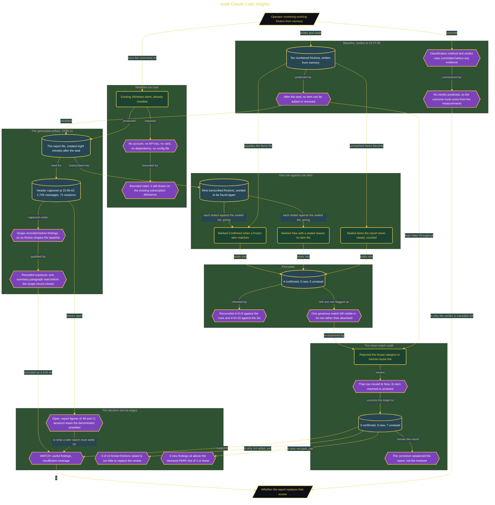

# Audit Claude Code Insights

> Part of [Fresh Off the Crown](../../README.md) · *A daily practice deciding what earns a place in the work.*

## Overview

Reviewing my own working friction runs on memory, which is slow and unreliable. A report generated from 1,745 messages across 71 sessions could replace it, but only if it finds what I already know is wrong, and any report feels accurate when read after the fact. So the question was whether it earns a place in the regular review, and answering that honestly meant fixing what I knew before the report existed.

The build is that ordering, enforced by timestamps. A numbered ten-item friction list was written from memory and sealed at 23:37:36. The report file was created at 23:45:11, nearly eight minutes later, and its count-bearing header was captured at 23:46:42 before any finding was transcribed. Nine report frictions were then compared one at a time against one frozen item each, marked Confirmed or New with a stated reason, while every sealed item the report never raised was counted as unraised. Method and verdict rules were committed first, so no result could set its own acceptance standard.

The first pass returned 4 confirmed, 5 new, and 6 unraised, reconciled by 4+5=9 against the rows and 4+6=10 against the list. A close-match audit then rejected the strongest link in it, where a broad report category had been matched to a narrower remembered cause, moving that row to New and returning its item to unraised for a corrected **3 confirmed, 6 new, and 7 unraised**. The correction cut against the report. Verdict **WATCH**: six findings memory missed keep it clear of PARK, which the declared rules place at 2 or fewer confirmed, but a report raising 3 of 10 known frictions cannot replace the review it was meant to replace. Two limits stay attached rather than smoothed away. I read one paragraph of the summary before closing the scope record, and the report's own 49-versus-71 session figures leave the denominator unsettled, which is what a later report has to resolve.

## Architecture

The diagram shows the topology and data flow of the system as built. The captured evidence for this run, including screenshots of what the tools actually returned, lives in [`documents/insights-sealed-baseline.md`](./documents/insights-sealed-baseline.md).

## Implementation

This system is built across **6 phases**:

1. Reaching an Evidence-Based Routine Verdict
2. Establishing a Zero-Setup Evaluation Path
3. Sealing a Pre-Run Decision Record
4. Capturing the Report Scope Before Findings
5. Turning First Impressions Into Traceable Findings
6. Auditing the Most Ambiguous Match

For the run as it happened, with the screenshots taken at each step, see [`documents/insights-sealed-baseline.md`](./documents/insights-sealed-baseline.md).

## Validation

Each phase below has its evidence in [`documents/insights-sealed-baseline.md`](./documents/insights-sealed-baseline.md), with the screenshots, configuration, and observed results recorded as the run happened:

- ✅ Reaching an Evidence-Based Routine Verdict
- ✅ Establishing a Zero-Setup Evaluation Path
- ✅ Sealing a Pre-Run Decision Record
- ✅ Capturing the Report Scope Before Findings
- ✅ Turning First Impressions Into Traceable Findings
- ✅ Auditing the Most Ambiguous Match
