# Measure What Concise Drops

> Part of [Fresh Off the Crown](../../README.md) · *A daily practice deciding what earns a place in the work.*

## Overview

Reading agent output is most of the working day, and "this answer feels clearer" is not a reason to change a setting. Output style gets chosen on impression rather than evidence, so a change that quietly drops something load-bearing looks the same as one that only trims padding. Nothing separated answer length from factual coverage.

The test locks the grading rules before anything runs. A sample codebase, six prompts, and three required items per prompt make 18 fixed facts, defined in advance so they cannot be revised after seeing which answer reads better. Scoring is strict: implication does not count, and saying the code "gives up after 3 tries" fails unless the answer also states that the failure is silent, with no exception and no log. Line count then measures how much text each style spends delivering those facts.

Default used 37 lines and Concise 22, a 41% reduction, with both retaining 18 of 18 required items. What disappeared was preamble, repeated context, and secondary advice. The custom output style written afterward is the one that earned the change: on the two prompts tested it ran 10 lines against Default's 15 while keeping two details neither scorecard asked for, that HTTP 429 is a retryable 4xx and that `timeout=30` applies per attempt, so a hanging server costs about 90s per SKU rather than 7. Three limits are named rather than discovered later: the Concise answers came from the Default session instead of a loaded `outputStyle` prompt, half the rows were graded against a reconstructed `report.py`, and because both styles scored perfectly the metric could not discriminate at all. Verdict **ADOPT** for the custom style, reversed if a prompt set whose required items include a caveat or refusal shows it dropping one.

## Architecture

```mermaid
---
title: Measure What Concise Drops
---
%%{init: {"theme":"base","themeVariables": {"primaryColor":"#1B4332","primaryTextColor":"#F4D03F","primaryBorderColor":"#F4D03F","secondaryColor":"#264653","tertiaryColor":"#2F5233","lineColor":"#F4D03F","fontFamily":"ui-monospace, SFMono-Regular, Menlo, Consolas, monospace","fontSize":"13px"}}}%%
flowchart TD
    classDef datastore fill:#264653,stroke:#F4D03F,stroke-width:2px,color:#FFFFFF
    classDef service fill:#1B4332,stroke:#F4D03F,stroke-width:2px,color:#F4D03F
    classDef event fill:#7B42BC,stroke:#F4D03F,stroke-width:2px,color:#FFFFFF
    classDef io fill:#0d1117,stroke:#F4D03F,stroke-width:1.5px,color:#F4D03F,font-style:italic

    Operator[/Reading agent output all day/]
    Decision[/Which output style to actually run/]

    subgraph Design["Scorecard locked before any run"]
        Codebase[(Sample codebase)]
        Prompts[(Six prompts)]
        Required[(18 required items, three per prompt)]
        PreCommit{{Grading rules fixed first, so they cannot be revised to favour a preferred answer}}
        Strict{{Strict rule: implication does not score, the fact must be stated}}
    end

    subgraph Baseline["Default run, the control"]
        DefaultRun(Six prompts at Default)
        DefLines[(37 lines)]
        DefScore[(18 of 18 required items)]
    end

    subgraph Short["Concise run, same six"]
        ConciseRun(Six prompts written tersely)
        ConLines[(22 lines)]
        ConScore[(18 of 18 required items)]
        Cut{{What was removed: preamble, repeated context, secondary advice}}
    end

    subgraph Result["What the numbers say"]
        Reduction{{41 percent fewer lines, zero scored facts lost}}
        NoDiscriminate{{Both perfect, so the metric could not separate the two styles}}
    end

    subgraph Custom["Secret mission: a custom style"]
        CustomStyle(Custom output style in Markdown with YAML frontmatter)
        CustomLines[(10 lines against Default 15, Concise 8)]
        Kept[(Kept: 429 is a retryable 4xx, timeout=30 applies per attempt)]
        Unscored{{Neither detail was scored, and both change the next action}}
    end

    subgraph Limits["Bounds on the claim"]
        NotIsolated{{Concise answers came from the Default session, not a loaded outputStyle prompt}}
        Reconstructed{{Half the rows graded against a reconstructed report.py}}
        NoCaveat{{No required item tested a caveat, refusal, or safety boundary}}
    end

    Operator -- "builds" --> Codebase
    Codebase -- "questioned by" --> Prompts
    Prompts -- "each carry three of" --> Required
    Required -- "locked by" --> PreCommit
    PreCommit -- "graded under" --> Strict
    Prompts -- "run at Default by" --> DefaultRun
    DefaultRun -- "measured as" --> DefLines
    DefaultRun -- "scored as" --> DefScore
    Prompts -- "rerun tersely by" --> ConciseRun
    ConciseRun -- "measured as" --> ConLines
    ConciseRun -- "scored as" --> ConScore
    ConciseRun -- "dropped only" --> Cut
    DefLines -- "compared against ConLines gives" --> Reduction
    ConLines -- "compared against DefLines gives" --> Reduction
    DefScore -- "tied with ConScore exposes" --> NoDiscriminate
    ConScore -- "tied with DefScore exposes" --> NoDiscriminate
    Operator -- "then writes" --> CustomStyle
    CustomStyle -- "measured as" --> CustomLines
    CustomStyle -- "preserved" --> Kept
    Kept -- "which are" --> Unscored
    ConciseRun -- "bounded by" --> NotIsolated
    Required -- "bounded by" --> Reconstructed
    Required -- "bounded by" --> NoCaveat
    Reduction -- "supports" --> Decision
    Unscored -- "is why the custom style wins" --> Decision
    NoDiscriminate -- "limits confidence in" --> Decision
    NotIsolated -- "limits confidence in" --> Decision
    NoCaveat -- "names the untested case for" --> Decision

    class Codebase,Prompts,Required,DefLines,DefScore,ConLines,ConScore,CustomLines,Kept datastore
    class DefaultRun,ConciseRun,CustomStyle service
    class PreCommit,Strict,Cut,Reduction,NoDiscriminate,Unscored,NotIsolated,Reconstructed,NoCaveat event
    class Operator,Decision io
```

The diagram shows the topology and data flow of the system as built. The full architectural narrative, with screenshots and prose, lives in [`documents/measure-what-concise-drops.md`](./documents/measure-what-concise-drops.md).

## Implementation

This system is built across **6 phases**:

1. Understanding the Experiment
2. Designing the Test: Six Prompts with Pre-Committed Required Items
3. Running the Baseline: Default Output Style
4. Switching to Concise and Running the Same Six
5. Reading the Scorecard: What the Numbers Say
6. Writing a Custom Output Style

For the full walkthrough with screenshots and step-by-step content, see [`documents/measure-what-concise-drops.md`](./documents/measure-what-concise-drops.md).

## Validation

Each build phase below is documented in [`documents/measure-what-concise-drops.md`](./documents/measure-what-concise-drops.md), with screenshots, configuration, and notes as captured during the build:

- ✅ Understanding the Experiment
- ✅ Designing the Test: Six Prompts with Pre-Committed Required Items
- ✅ Running the Baseline: Default Output Style
- ✅ Switching to Concise and Running the Same Six
- ✅ Reading the Scorecard: What the Numbers Say
- ✅ Writing a Custom Output Style
