# Package a Claude Code Workflow

> Part of [Fresh Off the Crown](../../README.md) · *A daily practice deciding what earns a place in the work.*

## Overview

Packaging repeatable work into a plugin feels like a win before anything is measured. The friction is that the obvious metric, how many steps you no longer perform, is not the metric that matters. A nine-action onboarding workflow could lose most of its steps and still cost the same afternoon, and nothing in an action count would say so.

The comparison is built so the subtraction stays valid. All nine actions are listed separately in their committed order, none merged, dropped, or renamed after the baseline, and each carries exactly one ownership label so the denominator is nine in both conditions. A rule forces the skill to walk every action and count each practitioner entry, which stops the package reporting a lower number by quietly skipping work it cannot do. The plugin is workspace-local and session-loaded, validated with strict error reporting first, because a partially loaded package could fall back to manual behaviour while still looking packaged.

The action count fell from 9 to 4, a 56% reduction. Elapsed time went from 00:46 to 00:45. **One second.** The five absorbed actions were cheap mechanical writes, while the four that remained, supplying the target, deciding what the status line should say, and judging the output, held nearly all the effort. So the package is kept, but explicitly not for speed: runs 2 and 3 both returned PASS with the same four remaining actions, and run 4 matched its prewritten failure condition on both required evidence halves and refused to repair a target it should reject. Verdict **ADOPT** for repeatable execution and safe refusal, with the 56% figure kept deliberately separate from effort because presenting them as equivalent would misstate the result. The audit also records what it cannot claim: no acceptance threshold was committed before the runs, so KEEP was a judgment the numbers support rather than one they force.

## Architecture

```mermaid
---
title: Package a Claude Code Workflow
---
flowchart TD
%%{init: {"theme":"base","themeVariables": {"primaryColor":"#1B4332","primaryTextColor":"#F4D03F","primaryBorderColor":"#F4D03F","secondaryColor":"#264653","tertiaryColor":"#2F5233","lineColor":"#F4D03F","fontFamily":"ui-monospace, SFMono-Regular, Menlo, Consolas, monospace","fontSize":"13px"}}}%%
    classDef datastore fill:#264653,stroke:#F4D03F,stroke-width:2px,color:#FFFFFF
    classDef service fill:#1B4332,stroke:#F4D03F,stroke-width:2px,color:#F4D03F
    classDef event fill:#7B42BC,stroke:#F4D03F,stroke-width:2px,color:#FFFFFF
    classDef io fill:#0d1117,stroke:#F4D03F,stroke-width:1.5px,color:#F4D03F,font-style:italic

    Practitioner[/Practitioner onboarding a target/]
    Decision[/Keep the package, or delete it/]

    subgraph Baseline["Manual baseline, recorded first"]
        Nine[(Nine actions, committed order)]
        AllHuman{{Before packaging all 9 belong to the practitioner}}
        Clock[(Elapsed 00:46)]
        BeforePkg{{Baseline recorded before the package existed}}
    end

    subgraph Package["Strictly scoped local plugin"]
        Manifest[(plugin.json and SKILL.md)]
        Strict(Strict validation before loading)
        Local{{Workspace level and session loaded, global settings untouched}}
        PartialRisk{{A silent partial load would look packaged while running manually}}
    end

    subgraph Fair["Keeping the subtraction valid"]
        NoRename{{No action merged, dropped or renamed after the baseline}}
        OneLabel{{Exactly one ownership label per action}}
        WalkAll{{Rule forces a walk of all nine, counting every practitioner entry}}
        SameDenom{{Denominator stays 9 in both conditions}}
    end

    subgraph Result["What actually moved"]
        Four[(4 practitioner actions remain: 1, 5, 6, 9)]
        Absorbed[(5 packaged: mechanical writes)]
        Pct{{56% fewer actions}}
        After[(Elapsed 00:45)]
        OneSecond{{One second saved}}
        Bottleneck{{The remaining four held nearly all the effort}}
    end

    subgraph Behaviour["Why it was kept anyway"]
        Run2(Run 2 PASS)
        Run3(Run 3 PASS)
        Consistent{{Same four remaining actions on both valid targets}}
        Run4(Run 4 against the prewritten failure condition)
        Refused{{Matched both required evidence halves and refused to repair the target}}
    end

    subgraph Honest["What the audit does not claim"]
        Arithmetic{{9 minus 4 equals 5, matching the five packaged steps}}
        NoThreshold{{No acceptance threshold was committed before the runs}}
        Separate{{The 56% figure is kept apart from effort, never presented as equivalent}}
    end

    Practitioner -- "performs" --> Nine
    Nine -- "owned as" --> AllHuman
    Nine -- "timed at" --> Clock
    Clock -- "captured under" --> BeforePkg
    Practitioner -- "builds" --> Manifest
    Manifest -- "checked by" --> Strict
    Strict -- "guards against" --> PartialRisk
    Manifest -- "scoped by" --> Local
    Nine -- "carried into the skill under" --> NoRename
    NoRename -- "paired with" --> OneLabel
    OneLabel -- "enforced by" --> WalkAll
    WalkAll -- "preserves" --> SameDenom
    SameDenom -- "makes the count meaningful in" --> Four
    Manifest -- "absorbs" --> Absorbed
    Absorbed -- "leaves" --> Four
    Four -- "expressed as" --> Pct
    Manifest -- "timed at" --> After
    Clock -- "compared with After gives" --> OneSecond
    OneSecond -- "explained by" --> Bottleneck
    Four -- "is" --> Bottleneck
    Manifest -- "exercised by" --> Run2
    Manifest -- "exercised by" --> Run3
    Run2 -- "with Run3 shows" --> Consistent
    Run3 -- "with Run2 shows" --> Consistent
    Manifest -- "exercised by" --> Run4
    Run4 -- "produced" --> Refused
    Arithmetic -- "checked against" --> Absorbed
    Pct -- "held apart by" --> Separate
    OneSecond -- "held apart by" --> Separate
    Consistent -- "supports" --> Decision
    Refused -- "supports" --> Decision
    OneSecond -- "argues against speed as a reason for" --> Decision
    NoThreshold -- "bounds the confidence in" --> Decision
    BeforePkg -- "gives provenance to" --> Decision

    class Nine,Clock,Manifest,Four,Absorbed,After datastore
    class Strict,Run2,Run3,Run4 service
    class AllHuman,BeforePkg,Local,PartialRisk,NoRename,OneLabel,WalkAll,SameDenom,Pct,OneSecond,Bottleneck,Consistent,Refused,Arithmetic,NoThreshold,Separate event
    class Practitioner,Decision io
```

The diagram shows the topology and data flow of the system as built. The captured evidence for this run, including screenshots of what the tools actually returned, lives in [`documents/packaged-workflow-payoff.md`](./documents/packaged-workflow-payoff.md).

## Implementation

This system is built across **3 phases**:

1. Measuring Whether the Package Earned Its Keep
2. Building a Strictly Scoped Local Plugin
3. Establishing a Clean Manual Baseline

For the run as it happened, with the screenshots taken at each step, see [`documents/packaged-workflow-payoff.md`](./documents/packaged-workflow-payoff.md).

## Validation

Each phase below has its evidence in [`documents/packaged-workflow-payoff.md`](./documents/packaged-workflow-payoff.md), with the screenshots, configuration, and observed results recorded as the run happened:

- ✅ Measuring Whether the Package Earned Its Keep
- ✅ Building a Strictly Scoped Local Plugin
- ✅ Establishing a Clean Manual Baseline
