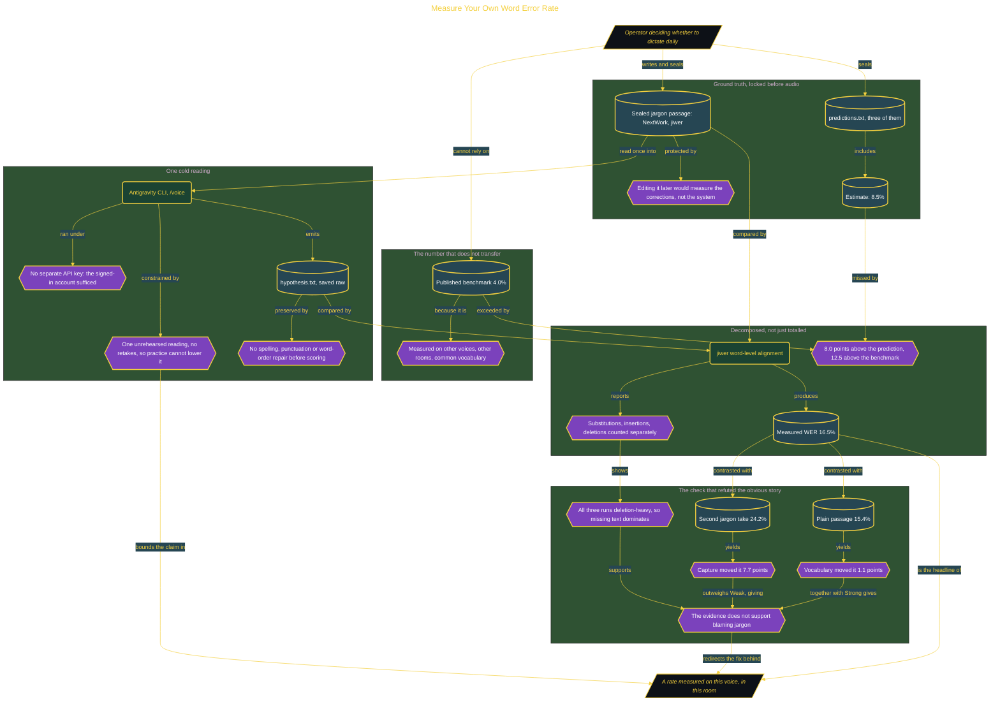

# Measure Your Own Word Error Rate

> Part of [Fresh Off the Crown](../../README.md) · *A daily practice deciding what earns a place in the work.*

## Overview

A published benchmark is measured on someone else's voice, vocabulary, microphone, and room. Trusting it as a personal number is the friction: dictation either earns a place in daily work or it does not, and 4.0% on clean speech says nothing about a passage carrying terms like NextWork and jiwer spoken into this microphone.

The design protects the ground truth in three places. The reference passage is written and sealed before any audio exists, because editing it after seeing the transcript would make errors vanish and measure the corrections rather than the system. Three predictions are sealed the same way, including an estimate of 8.5%. The passage is read once, unrehearsed, with no retakes, since a second take measures practice rather than a cold reading. And the raw output is saved untouched, because repairing spelling or word order before scoring removes exactly the substitutions, insertions, and deletions the score exists to count. Scoring runs through jiwer with word-level alignment, so the number decomposes instead of arriving as a verdict.

The measured rate was **16.5%**, eight points above the prediction and twelve and a half above the published benchmark. Two of the three predictions were wrong, which is the value of having sealed them. The sensitivity check is what makes the entry worth keeping: a plain-language passage scored 15.4% against the jargon passage's 16.5%, a gap of only 1.1 points, while a second jargon take scored 24.2%, a swing of 7.7 points on the same kind of material. Vocabulary is not the driver; how the recording was captured is. All three runs were deletion-heavy, so missing text moves the rate as much as word choice, and clipping could account for as much as the model. Verdict **WATCH**: not adoptable at 16.5%, plausibly fixable since the evidence points at capture rather than the model. Re-check 2026-09-05 with capture held constant. Reversed to reject if a controlled-capture rerun stays near 16.5%.

## Architecture

The diagram shows the topology and data flow of the system as built. The captured evidence for this run, including screenshots of what the tools actually returned, lives in [`documents/personal-word-error-rate.md`](./documents/personal-word-error-rate.md).

## Implementation

This system is built across **6 phases**:

1. Measuring My Own Word Error Rate
2. Setting Up the Tools
3. Sealing the Reference and Writing Predictions
4. Testing Dictation Cold
5. Recording the Passage Once
6. Proving the Measurement Is Sensitive

For the run as it happened, with the screenshots taken at each step, see [`documents/personal-word-error-rate.md`](./documents/personal-word-error-rate.md).

## Validation

Each phase below has its evidence in [`documents/personal-word-error-rate.md`](./documents/personal-word-error-rate.md), with the screenshots, configuration, and observed results recorded as the run happened:

- ✅ Measuring My Own Word Error Rate
- ✅ Setting Up the Tools
- ✅ Sealing the Reference and Writing Predictions
- ✅ Testing Dictation Cold
- ✅ Recording the Passage Once
- ✅ Proving the Measurement Is Sensitive
