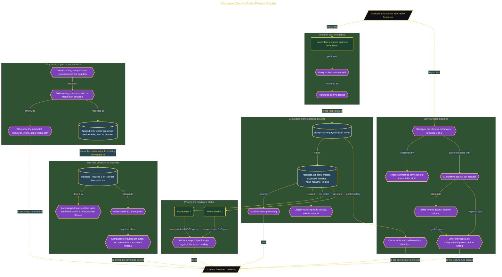

# Measure Claude Code Prompt Cache

> Part of [Fresh Off the Crown](../../README.md) · *A daily practice deciding what earns a place in the work.*

## Overview

Prompt cache behaviour is invisible unless something surfaces it, and a status line that reports the wrong thing is worse than none. The friction is twofold: the fields are not exposed where you would look for them, and a comparison between two surfaces can disagree for reasons that have nothing to do with either being wrong.

The first draft guessed from human-facing labels and root-level fields, so every lookup returned null and the line rendered as five dashes. The correction came from inspecting the captured JSON rather than guessing again, giving five real paths under `prompt_cache` and a verified 5 of 5 schema score. Two values need display handling, a ratio multiplied and rounded to 81% and a token count rendered as 48.2k. The line was then run under PowerShell 7 and 5.1, producing identical output that matched the saved reading byte for byte.

Two findings outlast the script. Equality between surfaces requires the same field definition **and** the same measurement window: an initial sweep of the obvious commands returned 0 of 5 because none of them carry these fields at all, and two later mismatches came from comparing cumulative against per-request values and billed against context tokens, which are different scopes rather than contradictions. Cache write matched exactly to the token, which is the strongest cross-surface confirmation available. Second, counters move on any turn, so both readings must be captured with no model turn between them or the comparison measures timing rather than correctness. The field semantics also check out: across two sessions `expected_rebuilds` climbed from 1 to 4 through an autocompact loop while `misses` held at 1, so compaction rebuilds are attributed rather than reported as unexplained misses. Verdict **ADOPT**. Reversed the moment a release changes the schema, with five dashes as the detector.

## Architecture

The diagram shows the topology and data flow of the system as built. The captured evidence for this run, including screenshots of what the tools actually returned, lives in [`documents/prompt-cache-status-line.md`](./documents/prompt-cache-status-line.md).

## Implementation

This system is built across **6 phases**:

1. Proving Status-Line Accuracy with Same-Moment Evidence
2. Correcting the Five-Field Status Line
3. Measuring Timing and Rebuild Behaviour
4. Scoring a Schema-Grounded Draft
5. Preparing an Authenticated Claude Code Environment
6. Investigating Claude Code Status-Line Reliability

For the run as it happened, with the screenshots taken at each step, see [`documents/prompt-cache-status-line.md`](./documents/prompt-cache-status-line.md).

## Validation

Each phase below has its evidence in [`documents/prompt-cache-status-line.md`](./documents/prompt-cache-status-line.md), with the screenshots, configuration, and observed results recorded as the run happened:

- ✅ Proving Status-Line Accuracy with Same-Moment Evidence
- ✅ Correcting the Five-Field Status Line
- ✅ Measuring Timing and Rebuild Behaviour
- ✅ Scoring a Schema-Grounded Draft
- ✅ Preparing an Authenticated Claude Code Environment
- ✅ Investigating Claude Code Status-Line Reliability
