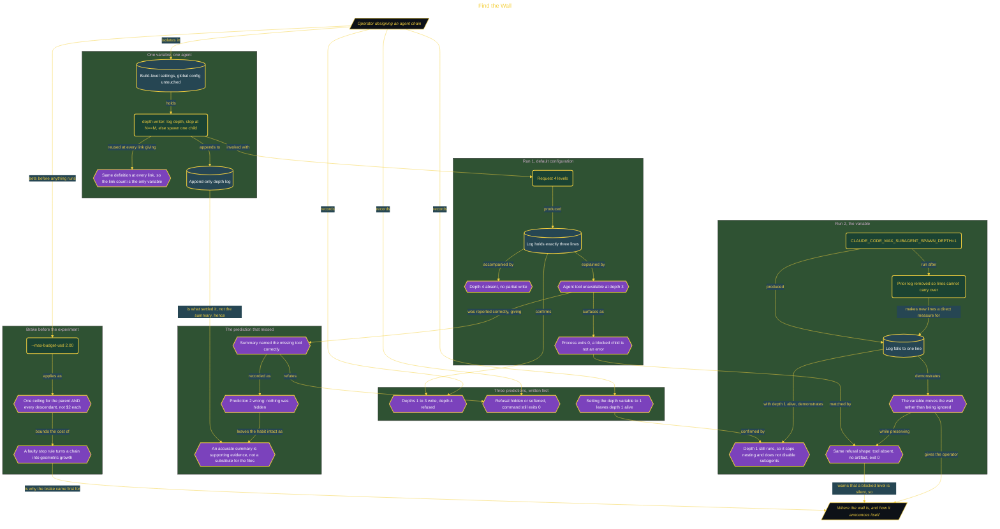

# Find the Wall

> Part of [Fresh Off the Crown](../../README.md) · *A daily practice deciding what earns a place in the work.*

## Overview

Agent chains fail quietly. A nested subagent that never runs does not raise an error, and if the depth limit is unknown, a design can be built on a level that will never execute. The friction is that nesting depth was a guess: no measured wall, no idea what a refusal looks like, and no way to tell a blocked level from a level that simply had nothing to do.

The rig keeps one thing moving. A single `depth-writer` agent logs its depth, stops when it reaches the target, and otherwise spawns exactly one child, so the link count is the only variable across runs. Configuration sits at the build level rather than in global settings, and `--max-budget-usd 2.00` runs as a hard brake over the parent and every descendant together rather than per agent, because a faulty stop rule turns a linear chain into geometric growth and the billing page is a bad place to discover that. Three predictions were written before the first run.

Requesting four levels produced exactly three log lines, with depth 4 absent and no partial write, so the wall sits after the third subagent link. Rerunning with `CLAUDE_CODE_MAX_SUBAGENT_SPAWN_DEPTH=1` dropped the log to one line, which shows the variable moves the wall rather than being ignored, and that it caps nesting without disabling subagents, since depth 1 still ran. The refusal shape held in both directions: the Agent tool is simply absent at the blocking depth, nothing is written, and **the process still exits 0**. One prediction was wrong in a useful way, that the summary would hide the failure. It named the missing tool accurately, which is worth recording precisely because it was checked rather than assumed. Verdict **ADOPT** for the variable as the nesting control and the budget flag as the recursion brake. Reversed if a run shows the variable ignored or the default wall moving on its own.

## Architecture

The diagram shows the topology and data flow of the system as built. The captured evidence for this run, including screenshots of what the tools actually returned, lives in [`documents/subagent-nesting-wall.md`](./documents/subagent-nesting-wall.md).

## Implementation

This system is built across **6 phases**:

1. Understanding the Experiment
2. Forming Predictions Before Running the Chain
3. Crossing the Nesting Wall and Reading the Evidence
4. Testing the Environment Variable
5. Proving the Wall Exists Both Ways
6. Going Further: Concurrent vs. Nesting Limits

For the run as it happened, with the screenshots taken at each step, see [`documents/subagent-nesting-wall.md`](./documents/subagent-nesting-wall.md).

## Validation

Each phase below has its evidence in [`documents/subagent-nesting-wall.md`](./documents/subagent-nesting-wall.md), with the screenshots, configuration, and observed results recorded as the run happened:

- ✅ Understanding the Experiment
- ✅ Forming Predictions Before Running the Chain
- ✅ Crossing the Nesting Wall and Reading the Evidence
- ✅ Testing the Environment Variable
- ✅ Proving the Wall Exists Both Ways
- ✅ Going Further: Concurrent vs. Nesting Limits
